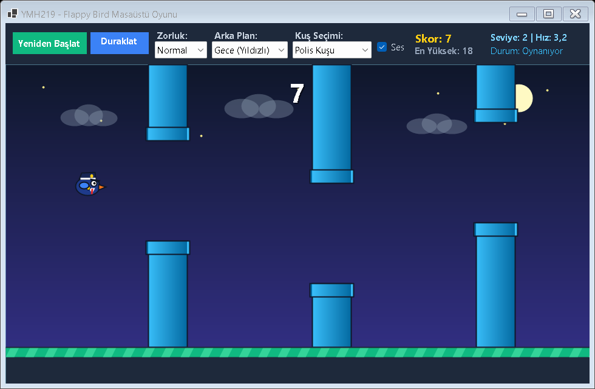
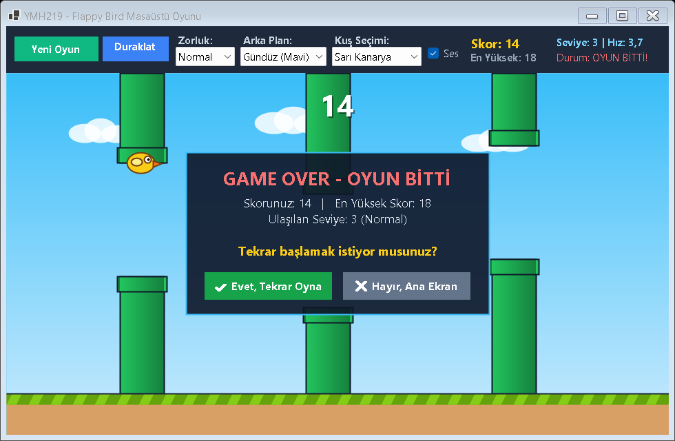

# YMH219-FlappyBird — Flappy Bird Benzeri Masaüstü Oyunu

**Nesne Tabanlı Programlama (YMH 219)** dersi 1. uygulama ödevi kapsamında geliştirilmiş, C# ve Windows Forms tabanlı **Flappy Bird** masaüstü oyunudur. Proje; zamanlayıcı (`Timer`) ile oyun döngüsü yönetimini, klavye/fare olaylarını (`KeyDown` / `ProcessCmdKey`), çarpışma algılamayı (`Rectangle.IntersectsWith`) ve nesne tabanlı (OOP) sınıf tasarımını göstermektedir.

---

## Kullanılan Teknoloji ve Kütüphaneler

* **Dil:** C#
* **Platform / Çerçeve:** .NET (`Windows Forms`)
* **Grafik Altyapısı:** `System.Drawing` / `System.Drawing.Drawing2D` (Çift tamponlu `DoubleBufferedPanel` ile titreşimsiz GDI+ çizimi)
* **Ses Altyapısı:** `System.Media` (`SystemSounds`)
* **Harici NuGet Paketi:** Yok (Tamamen standart .NET bileşenleri ile geliştirilmiştir)

---

## Sınıf ve Mimari Yapı (OOP Tasarımı)

Proje, sorumlulukların ayrılması (Separation of Concerns) prensibine uygun olarak katmanlı sınıflarla tasarlanmıştır:

* **`Models/Bird.cs`:** Oyuncunun kontrol ettiği kuşun konumunu (`X`, `Y`), dikey hızını (`VerticalVelocity`), yer çekimi ivmesini (`Gravity`), zıplama kuvvetini (`JumpStrength`) ve çarpışma sınırlarını (`Bounds`) kapsüller.
* **`Models/PipePair.cs`:** Ekranda sağdan sola kayan üst ve alt engel çiftini, aralarındaki geçiş boşluğunu (`GapTopY`, `GapHeight`), sola hareketi (`MoveLeft`) ve ekran dışına çıktığında yeniden konumlandırmayı (`Reposition`) yönetir.
* **`Models/DifficultyLevel.cs`:** `Kolay`, `Normal` ve `Zor` seviyelerine ait hız, boru aralığı ve yer çekimi parametrelerini tutar.
* **`Models/VisualThemes.cs`:** 4 farklı arka plan temasını (`Gündüz`, `Gün Batımı`, `Gece`, `Karlı Kış`) ve 6 farklı kuş görünümünü (`Sarı Kanarya`, `Kızıl Anka`, `Mavi Fırtına`, `Zümrüt Kuşu`, `Mor Gölge`, `Polis Kuşu`) renk paletleriyle birlikte yönetir.
* **`Models/GameState.cs`:** Oyunun anlık durumunu (`Ready`, `Playing`, `Paused`, `GameOver`) tanımlar.
* **`Services/GameManager.cs`:** Oyun döngüsünü (`UpdateFrame`), skor ve seviye artışını, çarpışma kontrolünü (`CheckCollision`) ve en yüksek skorun yerel dosyada (`highscore.txt`) saklanmasını yönetir.
* **`Forms/MainForm.cs` & `Forms/DoubleBufferedPanel.cs`:** Kullanıcı arayüzünü, klavye/buton etkileşimlerini ve 60 FPS GDI+ çizimini yönetir.

---

## Kurulum ve Çalıştırma Adımları

1. Depoyu bilgisayarınıza klonlayın:
   ```bash
   git clone https://github.com/duyareminezehra/YMH219-FlappyBird.git
   cd YMH219-FlappyBird
   ```
2. `YMH219-FlappyBird.sln` dosyasını **Visual Studio 2022 / 2026** ile açıp **F5 (Başlat)** tuşuna basın veya terminal üzerinden çalıştırın:
   ```bash
   dotnet build
   dotnet run
   ```
3. **Oyun Kontrolleri:**
   * **`SPACE` / `Yukarı Ok` / `W` / `Sol Fare Tıkı`:** Kuşu zıplatır (Hazır veya Game Over ekranındayken oyunu başlatır).
   * **`P` Tuşu veya `Duraklat` Butonu:** Oyunu duraklatır / devam ettirir.
   * **`R` Tuşu veya `Yeni Oyun` Butonu:** Oyunu sıfırlayarak yeniden başlatır.

---

## Uygulamanın Temel Özellikleri

* **Asgari Gereksinimler:**
  * Klavye (`Space`, `Yukarı Ok`, `W`) ve fare ile yukarı zıplayan, yer çekimi etkisiyle aşağı inen oyuncu/kuş.
  * Ekranda sağdan sola hareket eden ve sol sınırdan çıktığında rastgele yükseklikle yeniden konumlanan **3 adet boru çifti (engel)**.
  * Engel veya zemine çarpıldığında oyunun durması ve **Game Over** bilgi ekranının gösterilmesi.
  * Engeller başarıyla geçildikçe skorun otomatik artması.
  * **Yeni Oyun / Yeniden Başlat** ve **Duraklat** işlevleri.
* **Eklenen İsteğe Bağlı (Bonus) Özellikler:**
  * **En Yüksek Skoru Dosyada Saklama:** En yüksek skor `highscore.txt` dosyasına kaydedilir ve uygulama yeniden açıldığında yüklenir.
  * **Seviye İlerledikçe Hızın Artması:** Her 5 puanda bir seviye (`Level`) artar ve engellerin hareket hızı kademeli olarak hızlanır.
  * **Arka Plan Temaları ve Kuş Seçenekleri:** 4 farklı arka plan teması (`Gündüz`, `Gün Batımı`, `Gece`, `Karlı Kış`) ve 6 farklı kuş karakteri (`Sarı Kanarya`, `Kızıl Anka`, `Mavi Fırtına`, `Zümrüt Kuşu`, `Mor Gölge`, `Polis Kuşu`) seçilebilir.
  * **Game Over Tekrar Başlama Onayı:** Oyun kaybedildiğinde yanlışlıkla hemen yeniden başlamayı önlemek için *"Tekrar başlamak istiyor musunuz?"* sorusuyla birlikte **Evet, Tekrar Başla** ve **Hayır, Ana Ekran** seçenek butonları sunulur.
  * **Zorluk Seviyeleri ve Ses Efektleri:** Arayüzden `Kolay`, `Normal`, `Zor` seçimi yapılabilir ve ses efektleri açılıp kapatılabilir.

---

## Ekran Görüntüleri

### 1. Oyun İçi Aktif Görünüm


### 2. Çarpışma ve Game Over Görünümü


---

## Bilinen Sınırlamalar ve Geliştirme Notları

* Çizimler harici resim dosyası bağımlılığı olmaması (farklı bilgisayarlarda dosya yolu hatası vermemesi) için tamamen vektörel GDI+ (`System.Drawing`) ile gerçek zamanlı üretilmektedir.
* Çarpışma kontrolünde görsel adalet sağlamak amacıyla kuşun sınır kutusuna (`Bounds`) 3 piksellik iç pay uygulanmıştır.

---

## Öğrenci Bilgileri

* **Adı Soyadı:** Emine Zehra Duyar
* **Öğrenci Numarası:** 250541027
* **Ders:** YMH 219 — Nesne Tabanlı Programlama
